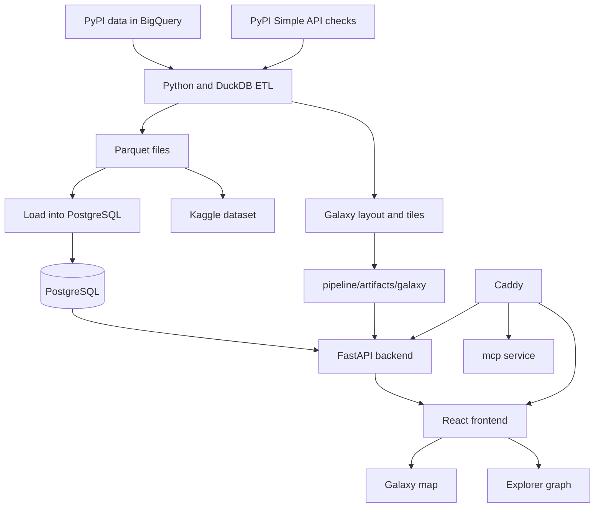

# PyPIMap project map

This file explains how the project is built and where to look in the code.

For live code details (hotspots, callers), use Ripwire. Do not paste those reports here.

## Purpose

PyPIMap helps people explore Python packages on PyPI.

Main parts of the site:

- **Galaxy** - a zoomable map of many packages. Search or click to select one.
- **Explorer** - a graph of **Depends on** and **Used by** for the selected package.
- **Guide** and **MCP docs** - help for people and for AI agents.

| Part | What it does | Where |
|---|---|---|
| Frontend | Galaxy, Explorer, search, package info | `frontend/src/` |
| Backend | API, database queries, HTML shells, Galaxy files | `backend/main.py` |
| Pipeline | Daily data from BigQuery into Parquet and Postgres; Galaxy tiles | `pipeline/` |
| MCP | Tools for AI agents over the public API | `mcp/` |
| Infra | Docker Compose, Caddy, Cloudflare, Hetzner | `docker-compose.yml`, `Caddyfile` |

## Engineering note

Most hard data work lives in the pipeline and SQL.

We do heavy work once (BigQuery, cleaning, name rules, dependency lists). Then the website and the Kaggle dataset reuse that data.

Prefer small daily updates and clear SQL unless a measurement shows you need something else.

## End-to-end flow



1. ETL reads package data from BigQuery and checks which packages are active.
2. It writes daily Parquet files under `pipeline/staging/raw_data/`.
3. DuckDB loads data into PostgreSQL (metadata and Depends on / Used by lists).
4. A Galaxy job rebuilds package positions and map tiles from Postgres. If Galaxy fails, the main ETL can still succeed (**fail-open**).
5. FastAPI serves the API, HTML pages for search engines, and `/galaxy/*` files.
6. The site opens on Galaxy. Explorer opens when you focus a package.
7. The same Parquet files also feed the public Kaggle dataset.

## Kaggle dataset

[PyPI Daily Package Profiles & Analytics Graph](https://www.kaggle.com/datasets/naelaqel/pypi-daily-metadata-and-analytics-base-dataset) (CC BY 4.0).

It updates from the `daily_parquet_after_etl` branch.

- Raw files: `raw_data/year={year}/month={month}/{day}.parquet`
- Snapshot file: `pypi_package_snapshot.parquet`

Useful fields in the snapshot:

- stable package IDs
- `active_version` (PEP 440; prefer a final release)
- `last_upload_date` (latest upload time)
- `importance_score` = core Used by + `0.3 ×` optional Used by
- precomputed Depends on / Used by ID lists

## Deploy

Production path: **Cloudflare → Caddy → Docker** on Hetzner.

- App code: `/app/prod` on branch `main`
- ETL data copy: `/app/etl` on branch `daily_parquet_after_etl`

Compose services: `postgres_db`, `db_seeder`, `backend`, `frontend`, `mcp`, `caddy`, `pipeline` (cron profile).

Caddy routing:

- These paths go to FastAPI: `/` (home only), `/package/*`, `/explore*`, `/guide`, `/mcp`, `/galaxy/*`, sitemap, crawler files
- Other `pypimap.com` paths go to the frontend
- `api.pypimap.com` → FastAPI
- `mcp.pypimap.com` → MCP service

## Pipeline

### Start

`pipeline/etl.py` runs in order:

1. Extract (`etl_to_raw_data.py`)
2. Load into Postgres (`fill_pg.py`)
3. Rebuild Galaxy (`run_galaxy_post_etl.py`) - fail-open

If extract/load fails, the run fails. If only Galaxy fails, package data is still OK.

### Extract and load

- `etl_to_raw_data.py` + `pipeline/sql/bigquery.sql` → Parquet
- `fill_pg.py` + SQL under `pipeline/sql/` → Postgres
- Full recreate uses stage tables, then rename in `pg_direct_migration.sql`

### Main tables

| Table | Role |
|---|---|
| `pypi.indecies` | Numeric IDs for package names |
| `pypi.metadata_cdc` | History of metadata |
| `pypi.metadata` | Current metadata and scores |
| `pypi.package_connections` | Depends on / Used by IDs and counts |

The spelling `indecies` is old and kept on purpose. Rename only with a careful migration.

### Galaxy after ETL

1. `run_galaxy_post_etl.py` calls `build_galaxy_from_pg.py`
2. Positions come from `galaxy_layout.py` (see next section)
3. `build_map_tiles.py` writes tiles under `pipeline/artifacts/galaxy/`
4. The graph file stores **nodes only**. Pin edges come from the live `/graph` API (not a big `neighbors.json` file)

## Galaxy node placement

Code: `pipeline/scripts/galaxy_layout.py`.

Idea: group packages around important hubs, then place them on a soft oval shape.

1. Pick the top Used-by packages as hubs (with a max count).
2. Assign every package to a hub with BFS on core dependency links (both directions).
3. Place hubs with a sunflower pattern. Place members near their hub the same way.
4. Lightly push overlapping points apart inside a cluster (skip heavy full pairwise work on huge graphs).
5. Stretch the X axis (`oval_aspect`), then center the map.

## Backend

Main file: `backend/main.py`.

- SEO HTML pages: `/`, `/guide`, `/mcp`
- App links (not for Google index): `/explore`, `/explore/{name}`, `/package/{name}`
- API: `/search`, `/package/api/{name}`, `/graph/.../depends-on`, `/graph/.../used-by`, `/last_update`
- Small sitemap (home, Guide, MCP) plus `robots.txt`, `ai.txt`, `llms.txt`
- `/galaxy/*` serves tile files from `GALAXY_ARTIFACT_ROOT`

## Frontend

- Default screen: Galaxy
- Explorer: force graph for Depends on / Used by
- App shell and state: `App.jsx`, `AppShell.jsx`, `appStore.js`
- Explorer data: `useGraphData.js` → API → `GraphCanvas.jsx`

## Where to start

| Task | Open first |
|---|---|
| API, graph, SEO pages | `backend/main.py` |
| Daily ETL control | `pipeline/etl.py` |
| BigQuery → Parquet | `pipeline/scripts/etl_to_raw_data.py` |
| Postgres load | `pipeline/scripts/fill_pg.py`, `pipeline/sql/` |
| Recreate tables | `pg_create_tables.sql`, `pg_direct_migration.sql` |
| Galaxy layout / tiles | `galaxy_layout.py`, `build_galaxy_from_pg.py`, `build_map_tiles.py` |
| Galaxy UI | Galaxy files under `frontend/src/` |
| Explorer graph | `useGraphData.js`, `GraphCanvas.jsx` |
| MCP tools | `mcp/src/pypimap_mcp/server.py` |
| Deploy | `docker-compose.yml`, `Caddyfile`, `CONTRIBUTING.md` |

## What is next

**Release 3** (2026-11-26) is live: Galaxy, SEO shells, hosted MCP on `main`.

**Release 4** is cleanup (IndexNow/`seo_cache` gone in code, ETL log markers, docs, MCP copy, brand assets).

## Ripwire

```bash
.tools/ripwire . --recall="<task>"
.tools/ripwire . --pack-task="<task>" --token-budget=10000
.tools/ripwire . --exemplar="<subtask>"
.tools/ripwire . --edit-check=<symbol>
.tools/ripwire . --situ
.tools/ripwire . --quality-delta
```

Put long-lived notes in `.ripwire_notes`. Do not store temporary Ripwire numbers in this file.
